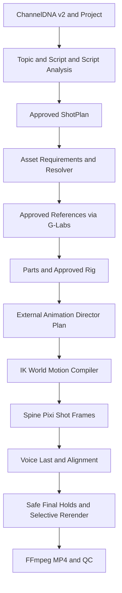

# 2D Animation Studio — Clean-Cutover Implementation Plan v3

**2026-10-16 ACCEPTED product amendment — WINDOWS_ONLY_TEST_POLICY (D-010):** This is a Windows-only app. All active C0–C12 CI must use Windows/PowerShell; refer to `docs/qa/WINDOWS_ONLY_TEST_POLICY.md` for phase-specific testing, rather than repeating the policy here. Primary release target is Windows 11 x64; Windows 10 x64 requires separate consumer-OS evidence. `windows-latest` GitHub Actions (Windows Server) does not prove either consumer target. Prior Ubuntu runs are historical YTB evidence, not required animation gates. C1 and C12 must include actual-target evidence. C2 deletes the legacy YTB CI/workflows and replaces them with animation-only Windows gates. No C2–C12 test suite is added in C0.

**Status:** REVIEWED IMPLEMENTATION BLUEPRINT — not implemented; every production gate still requires evidence.  
**Review date:** 2026-10-15 (Asia/Ho_Chi_Minh).  
**Only implementation repository:** `https://github.com/plthien/2D-Animation-Studio`.  
**Verified destination baseline:** `main` @ `b35834808d99067e362a6e728ce7af8e04d2b6bd` (`first commit`).  
**Read-only reference:** `plthien/ytb-ai-studio/main` @ `393d0eb5516ac8bb8455f859b79bfc64388b128e`.  
**Verification:** 813 tracked files in each, identical file paths and blob SHA for all 813, differences 0 added / 0 deleted / 0 changed. The new repository has a *different commit history*, although its tracked file tree is identical.  
**Not an implementation source:** `plthien/AI-2D-Animation-Studio`, PR #2, and abandoned prototype branches. Do not merge, cherry-pick or copy them.

## 0. Explicit user decision: CLEAN CUT, not a compatibility migration

This document **supersedes v2**, notably v2 §§0(2–3), 3.1–3.2, M2/M3, all references to `animation mode`, additive migration `032+`, old database compatibility and preservation of YTB ChannelDNA V3 as the production authority.

The cloned repository is a **new product**. The user does **not** need its old database, old user data, old video pipeline, old product modes, old migrations, or compatibility with YTB artifacts. The objective is to reuse high-value working *source code and UX*, not YTB's persisted state or old behavior.

**Authoritative clean-cut decisions:**

1. **ONE PRODUCT:** 2D Animation Studio. No YTB mode, `legacy_mode`, animation-mode switch, dual router, compatibility API, fallback render path, converter, importer of old YTB data, or old-flow background worker.
2. **ONE DATABASE:** a **new SQLite DB** (`sqlite:///./2d_animation_studio.db` default); a newly authored Alembic `0001_animation_initial.py` with a fresh schema. Remove the **31 YTB migration files** from the working tree, not merely disable them. No `032+` extension strategy, no YTB table backfill, no migration from YTB databases. New-schema migrations `0002+` only for future clean animation changes.
3. **NO OLD DATA:** do not load, import, synthesize, convert, preserve or migrate old Scene/Beat/Voice-first rows, YTB project artifacts or old model state. Keep an old database *on disk*, if found, untouched; never delete user files automatically. A new product clone need not erase an unrelated user's data.
4. **ONE CANONICAL IDENTITY:** Animation-first **`channel_dna.v2`** proposed as the clean canonical JSON contract. Keep the YTB Channels UI layout/editor UX, **replace V3 field schema/validators/storage**. Do not keep ChannelDNA V3 plus AnimationProfile side-by-side and do not maintain two sources of truth. A change to schema name/shape requires explicit contract review before code.
5. **ONE CANONICAL PIPELINE:** `authoring → resolver → generation → rigging → director → motion → delivery`; voice **last**. Remove old Scene Breakdown/Beat/VisualPlan/Voice-first/Assembly/Ken Burns production routes and UI *as live product code*. No hidden behavior returning fake success.
6. **PRESERVE REAL UI:** Keep actual `CockpitShell`, `GlobalSidebar`, `PageHeader`, `PipelineStepper`, shared components, card grids, typography, CSS/design tokens, selection UX and dialogs. Adjust names, domain data and stage panels, not the visual language. Never replace these with a generic new MUI AppBar + plain Card list.
7. **REUSE NEUTRAL SERVICES:** SQLAlchemy base/session/SQLite tuning, immutable artifact mechanics after auditing, strict external JSON parser/prompt packaging, durable provider coordinator, G-Labs HTTP transport, settings/security helpers, Kokoro/ElevenLabs synthesis & alignment, FFmpeg/process supervision — but no YTB data models, legacy stage authorities, still-image motion, old Voice-first orchestration or their old routers.
8. **DELETE obsolete code** rather than preserving `legacy/`, `compat/`, unused V4 modules or dead schemas/tests. Extract useful functions to clean namespaced modules before deleting a source file. Git history and the fixed donor SHA remain available as read-only references.
9. **NO paid or hidden calls:** external AI authoring = copy prompt → external generation → strict JSON import → review/approve. G-Labs paid requests require explicit user confirmation; ambiguous submission is reconciled rather than retried blindly. No background LLM or external research API.
10. **NO false runtime claim:** the product is *not* done just because UI/DB/OpenAPI compile. Real Spine animation, source-image auto-rig, multi-shot rendering and voice mux need independent measured gates.
11. **ONE released route graph:** after the cutover, runtime/OpenAPI, worker entrypoints, package scripts and launcher must contain **zero reachable old Scene/Beat/voice-first/static-image API paths**. No stale service startup side effects.
12. **NO forced deletion or history rewrite:** edit only the new repository, use feature branches/PRs, do not delete user files/DBs outside Git-tracked obsolete project files, do not rewrite Git history/force-push and do not edit donor `ytb-ai-studio`.

### Decisions that are explicitly NOT retained from v2

| v2 approach (retired) | v3 replacement |
|---|---|
| Keep `alembic/versions/001..031`; apply these to animation DB, then add 032+ | **Delete** 001..031; create a **fresh animation-only 0001** |
| Preserve YTB persisted tables and extend with animation records | Brand-new DB schema with no old columns/tables or YTB pointers |
| Add animation mode and quarantine the old runtime | **Single new runtime**; physically remove old routes/services/schema/tests once extracted |
| Keep ChannelDNA V3 and add Animation Profile | **One** `channel_dna.v2` animation-first contract, with visual/performance/narration domains |
| Separate YTB production routes continue existing but disabled for animation | Old production endpoints **do not exist** in final OpenAPI |
| Old workflows remain as inert compatibility code | Delete superseded old workflow files, tests, config and docs; retain only documented neutral code |
| Later optional migration from old data | **No data migration requirement** and no import/backfill implementation |

## 1. Verified source audit and failure risks

This is based on **direct GitHub source reads**, not a runtime test of the user's Windows clone. M0 must verify runtime, tests and screenshots locally.

| Observed code | Verified fact | Clean-cut implication |
|---|---|---|
| `src/layout/{CockpitShell,GlobalSidebar,PageHeader,PipelineStepper}.tsx`, `src/theme/theme.ts`, `src/index.css` | YTB's actual cockpit UI is present | **KEEP visual layout**; refactor data props + pipeline steps |
| `src/features/channels/*`, `src/features/projects/*` | Full channel/editor/modal/card UX exists | **KEEP UX**, replace V3 model and old project fields; do not copy PR #2 UI |
| `src/App.tsx`, `src/app/workspace.ts`, `src/pages/StudioPage.tsx`, `src/features/studio/types.ts` | Routing/selection and Studio stage state are coupled to YTB data | **REWRITE wiring**, preserve shell and interaction patterns; delete old stage selections |
| `app/main.py:75–115` | Mounts old Scene/Voice/Render routers and recoveries | **REBUILD route composition**; no old runtime side effects |
| `app/core/config.py:34,105` | Defaults to `youtube_ai_studio_v3.db` | Replace default; fail closed on old DB schema/path |
| `app/db/models.py:41–68` | Old `Project` has ScenePlan, Beat, Voice-first pointers | **REPLACE model**, not additive migration |
| `alembic/versions/` | 31 old YTB revisions | **DELETE from working tree**; write new `0001` |
| `app/modules/platform/invalidation.py` | Voice approval clears Scene/VisualPlan pointers | **DELETE/rewrite**; voice-last cannot invalidate approved ShotPlan/action semantics |
| `app/modules/v4/` | 117 old domain files including Scene, Voice and render; some reusable primitives inside | **EXTRACT neutral helpers → DELETE all old V4 tree** |
| `app/modules/media/glabs_webhook_client.py` | Transport includes status/download/validation | **KEEP/ADAPT** transport; strip YTB domain coupling |
| `app/modules/media/durable_workflow/*` | Durable coordinator and lease logic exists | **KEEP/ADAPT** neutral scheduler with brand-new operation tables |
| `app/core/external_authoring.py` | Strict duplicate-key JSON, schema bundling and reserved IDs | **KEEP/ADAPT** for new ShotPlan/Director contracts |
| `app/modules/v4/durable_voice_service.py` | Voice-first orchestration is large and tightly coupled | **REPLACE orchestrator**; extract isolated providers, pacing and alignment |
| `app/modules/v4/render_ffmpeg.py` and `render_graph.py` | Render still-image crop/motion graph | **DELETE motion graph**; extract FFmpeg process/validation only |
| `start.bat`, `scripts/windows/*` | Starts API + old media host + old render host + frontend | **REWRITE launch composition** and filenames/titles/stamps |
| `MANIFEST.json`, `tools/package_manifest.py`, `tools/manifest_authority/*`, `tests/platform/test_manifest_authority.py` | Describe/validate YTB V3 authority & old contracts | **DELETE or replace** obsolete package metadata; not the same as animation artifact manifests |

### Findings / uncertainty classification

- **Verified by source:** clone equality, route mounts, old default DB, old project model, old voice invalidation, old UI layout, source availability for G-Labs/voice/process primitives.
- **Not yet proven locally:** current baseline passing on this user's Windows machine; existing UI screenshots; runtime legal availability; deterministic Spine animation; automatic image segmentation quality; full paid G-Labs/voice execution.
- **Do not infer feasibility from source existence:** the cloned source contains **no completed native cutout auto-rig, IK/world-state motion compiler or official Spine-Pixi shot renderer**.

## 2. The one new production flow

### 2.1 User experience — exactly seven top-level stages

| Stage | Required user actions | Authoritative artifacts | Release prerequisite |
|---|---|---|---|
| **1 Authoring** | ChannelDNA v2 create/edit; Project; Topic Ideas → Script + Script Analysis/continuity review as appropriate → external ShotPlan prompt/import/approve | `channel_dna.v2`, `topic_ideas.v1`, `script.v1`, optional `script_analysis.v1`, `shot_plan.v1` | Approved current ShotPlan + consistent source context |
| **2 Resolver** | Review deterministic asset requirements, reuse existing same-channel asset versions, bind approved exact versions | `asset_requirements.v1`, `asset_resolution.v1` | Every required actor/prop/background/view/capability resolved or requires generation |
| **3 Generation** | Explicitly approve G-Labs spending; generate and review candidate reference/parts/background/props; approve asset versions | `asset_version.v1`, generation operation records | Approved, immutable assets with source/file provenance |
| **4 Rigging** | Inspect automatically inferred parts/joints, correct segmentation/pivots, verify preview poses, approve rig | `parts_manifest.v1`, `rig_profile.v1`, `rig_manifest.v1` | Loadable approved Spine 4.2 skeleton, atlas and action capability map |
| **5 Director** | Copy external Animation Director prompt, import/validate/approve JSON motion instructions | `animation_plan.v1` | Executable supported actions only, no invalid prop/actor timeline |
| **6 Motion** | Compile world-state/IK/locomotion, preview shots in Spine/PixiJS, approve rendered frames | `compiled_film.v1`, `render_manifest.v1` | Deterministic real rig-based frame renders and QC |
| **7 Delivery** | Generate and align **voice last**, reconcile safe holds, selectively rerender if necessary, mux MP4 and final QC | `voice_manifest.v1`, `final_timeline.v1`, `final_video.v1`, `qc_report.v1` | Audible 24fps 720p MP4 with exact audio/video lineage |

Only one instance of each stage authority; internal authoring substeps (Topic, Script, Script Analysis, ShotPlan) are **not** a second parallel pipeline. Keep the cockpit's tabs, stage progress and status indicators; stage names/contents change.



### 2.2 MVP frozen technical envelope

- Windows 10/11 x64 local-first, Python 3.12, Node 22, preserve React 18, MUI 5, Tailwind-based cockpit; choose tested security-patched Vite/tooling through an explicit dependency PR.
- Resolution **1280×720**, **24 FPS CFR**. PCM16 **mono 48,000 Hz**, exactly **2,000 audio samples per video frame** in canonical intermediate reconciliation.
- Max **30 shots**, shot base duration **24..720 frames**; max **2 humanoids** and **3 scene props** per shot; one grasped prop/hand; grounded 2D x-right/y-up in meters, nominal 100px/m at zoom1.
- Nine supported semantic actions only: `idle`, `walk_to`, `look_at`, `reach_for`, `grab`, `carry_to`, `place_at`, `point_at`, `react`.
- All timelines are **integer frame** and half-open intervals `[start_frame,end_frame)`. No inferred 3D motion, jumps, combat, cloth simulation or phoneme lip-sync in MVP.
- Approved terminal holds may add **at most 48 frames per shot**, giving ≤768 *final* frames/shot and ≤23,040 *final* frames/film. Do not stretch/truncate unapproved audio to force fit. Silent shots are supported.
- Rig representation: reviewed **14 transparent semantic sprites**, **16 mandatory semantic skeleton roles**, and explicitly approved additional actual bones up to 64 where valid. Bones must be present as contractually declared; no invented hidden body parts without review.
- Official Spine runtime proposal: Spine JSON/atlas **4.2**, `@esotericsoftware/spine-pixi-v8` matching 4.2, PixiJS v8 **≥8.16**. Exact patched versions and integration license must be verified and frozen at C1; no “latest” or mismatched data/runtime.
- Every immutable artifact has owned project/channel ID, canonical schema version, source revision IDs, SHA-256 of bytes, creation/review actor + time and dependent style hashes. No in-place edit after approval.

### 2.3 Hard product exclusions

No YTB Scene/Beat graph, `beat_timing_map`, `visual_plan`, `scene_asset_manifest`, old Prompt Composer, old AssemblyPlan, Ken Burns/static-image motion graph, voice-first prerequisite, voice-first invalidation, legacy YTB artifact reader, old migrations, migration script from YTB to animation, Genielabs source code or internal LLM SDK.

## 3. Source reuse / replacement / deletion matrix

**Status meaning:** `KEEP` = preserve actual implementation (with security/brand tweaks); `ADAPT` = preserve executable neutral business logic but rewrite domain interfaces; `EXTRACT` = transplant isolated functions and tests into new modules **before deleting old owner file**; `DELETE` = remove from active tracked tree by C2; `NEW` = build new engine.

| Classification | Source file(s) | New target / justification |
|---|---|---|
| **KEEP** | `src/layout/{CockpitShell,GlobalSidebar,PageHeader,PipelineStepper}.tsx`, `src/components/ui/*`, `src/theme/theme.ts`, `src/index.css`, `tailwind.config.js` | Actual visual components and tokens retained, no generic redesign |
| **ADAPT** | `src/App.tsx`, `src/app/workspace.ts`, `src/features/channels/*`, `src/features/projects/*`, `src/pages/{ChannelsPage,ProjectsPage,StudioPage,SettingsPage,JobsPage,ArtifactsPage}.tsx` | Keep UX and navigation; new DTOs, stage labels, valid readiness, animation-only settings |
| **ADAPT** | `src/features/studio/{StudioPipeline,PromptImportWorkspace,TopicIdeasPanel,ScriptPanel,ActiveOperationsDrawer,useProgressiveLimit}.tsx` (check actual extensions on each) | Keep proven interaction pattern; rebind to new artifacts and external authoring |
| **DELETE** | `src/features/studio/{SceneBreakdownPanel,SceneAssetsPanel,AssemblyPanel,RenderPanel,VoicePanel,StyleBibleVisualReferencesWorkspace,StyleBibleVisualReferencesWorkspaceV2}.tsx`, old `types.ts` stage enum | Superseded voice-first/static scene UI; new panels added separately |
| **KEEP/ADAPT** | `app/core/{ids,hashing,time,external_authoring,diagnostic_redaction}.py`, `app/api/errors.py`, `app/db/{base,session,sqlite_pragmas,types}.py`, `app/infrastructure/sqlite.py` | Neutral ID/validation/connection/error infrastructure with new names and schema |
| **REWRITE** | `app/core/{config,version}.py`, `app/main.py`, `app/db/{models,migrations}.py`, `alembic/env.py`, `app/api/routes/{platform,settings,jobs,artifacts,system}.py`, `app/repositories/core.py`, `app/modules/platform/{services,invalidation}.py` | Fresh animation domain; no old pointers or old startup imports |
| **KEEP/ADAPT** | `app/modules/media/{glabs_webhook_client,bounded_http_transport,transport_policy,image_upload_validation,media_secret_safety,media_provider_errors}.py` | Retain secure HTTP and user-approved generation; no Beat/Anchor assumptions |
| **ADAPT** | `app/modules/media/durable_workflow/*`, `app/repositories/durable_workflow_protocol.py` | New operation lease/owner/retry safety; no YTB physical task tables |
| **EXTRACT** | `app/modules/v4/{voice_provider_adapters,voice_pacing,voice_pacing_calibration,voice_pacing_calibration_settings,voice_alignment,voice_audio,elevenlabs_*}.py`, `kokoro/*` | New `app/modules/animation/voice/` provider and pacing modules; preserve Kokoro CLI sources, not model binaries/user settings |
| **EXTRACT** | `app/modules/v4/{host_owned_process,windows_job_object,windows_subprocess_guard,render_process_diagnostics,render_validation}.py`; process-safe portions of `render_ffmpeg.py` | `app/core/process/`, `app/modules/animation/delivery/ffmpeg_runner.py` |
| **DELETE** | `app/modules/v4/` entirely **after extraction**, including SceneBreakdown, Beat, SceneAsset, old Voice-first/Assembly/render_graph and wrappers | No dead legacy V4 tree retained in animation application |
| **DELETE** | `app/db/{scene_asset_*,visual_reference_*}.py`, old `app/repositories/{scene_asset_*,visual_reference_*,voice_*,render_durable_working}.py`, old YTB domain routers, legacy app runners | Do not keep old worker/runtime ownership alongside new |
| **DELETE** | `alembic/versions/001_*.py` through `031_*.py` | Replace with `0001_animation_initial.py` and new revision chain |
| **DELETE** | `contracts/schemas/v4/*`, YTB-only `contracts/prompts/v4/*`, old fixture/contracts/examples not used by clean animation, `tests/v4/*`, tests enforcing obsolete YTB semantics | New contract pack and positive/negative tests |
| **DELETE** | `MANIFEST.json`, YTB-specific package manifest authority baselines/patches, obsolete manifest verification tests and scripts where no longer used | Product manifest describes old modes; **does not mean deleting `rig_manifest.v1` or frame manifests** |
| **REWRITE** | `start.bat`, `scripts/windows/*`, `.github/workflows/*`, `README.md`, `00_START_HERE.md`, `docs/99_SOURCE_OF_TRUTH.md`, API generated clients/OpenAPI | Only animation commands and production owners remain |
| **NEW** | `app/modules/animation/{platform,authoring,assets,rigging,director,motion,renderer,delivery,voice}`, `runtime/spine/`, `contracts/animation/`, `src/features/animation/` | New world/rig/motion/domain behavior |

**File-level audit requirement:** Before C2, create `docs/architecture/CLEAN_CUT_FILE_LEDGER.md` covering *every* tracked path and its `KEEP|ADAPT|EXTRACT|DELETE|NEW` decision, reason, destination, dependency references, and test. The table above is an owner-level map, **not authorization for blind recursive deletion**. Keep the source SHA/provenance for each extracted function. At C2, detect and fail on dangling imports/references.

## 4. Fresh platform: no legacy schema, no legacy migration

### 4.1 Brand-new boot contract

Default values:

```text
APP_NAME=2D Animation Studio
DATABASE_URL=sqlite:///./2d_animation_studio.db
ARTIFACT_ROOT=./local_artifacts
HOST=127.0.0.1
API_PORT=8000
FRONTEND_PORT=5173
AUTO_APPLY_MIGRATIONS=true
```

- Remove defaults `youtube_ai_studio_v3.db`, `YouTube AI Studio`, `.yas3_*`, old background worker launcher names and old render provider settings.
- Fresh install creates the new database and **only animation schema**. Brand-new `0001_animation_initial.py` establishes the new Alembic lineage. Do not retain a reference to `031_voice_generation_providers` or the old YTB Alembic `down_revision`.
- Old DB files remain **untouched**. If the configured target file already has YTB tables / Alembic version from YTB, startup **fails closed** with `LEGACY_DATABASE_UNSUPPORTED` and clear instructions to choose a different path. It must never auto-drop, auto-convert or silently run old migrations.
- A new animation database at an older animation revision is upgraded by the new migration chain (where applicable). For a fresh empty DB, no legacy columns/tables should be created, even temporarily.
- For tests, create and tear down DB **only under an explicit disposable test root**. Do not use `DROP ALL` against a default/user DB. Use isolated SQLite files and artifact roots for each test; no hidden global state.
- SQLite `PRAGMA foreign_keys=ON`, WAL, busy timeout, no shared write Session across worker threads. Test restart, concurrent CAS, dangling filesystem temp and crash recovery; never hold write lock during paid IO or large file writes.

### 4.2 Initial canonical table set (proposal to freeze in C0)

Adopt a **14-table animation-first initial schema** (from the previously reviewed animation foundation vocabulary, not the old YTB models). C0 freezes exact column types, constraints, indexes and FK graph in `contracts/animation/DB_SCHEMA.md` *before* C2 writes migration code.

1. `channels` — metadata, current ChannelDNA revision pointer and visual/performance/narration hashes.
2. `projects` — channel reference, metadata and status; **NO Scene/Beat/Voice-first pointers**.
3. `project_stage_heads` — `(project_id, stage_key)` unique current immutable artifact ID, `approval_status` of `draft|approved|rejected`, dependency fingerprint; readiness `stale` **computed**, not stored in approval.
4. `artifacts` — immutable version, channel/project, kind, logical key, SHA/size/path, parents, source hashes, metadata and approval.
5. `authoring_reservations` — reserved IDs, source revision/hash, status, expiry, consumed identity for import CAS.
6. `assets` — channel-owned logical asset identity, kind, semantic key, view domain.
7. `asset_versions` — immutable approved candidates, source refs, style and capability hashes.
8. `project_asset_bindings` — project-specific pins to exact approved asset version(s).
9. `rigs` — reusable asset-owned rig identity.
10. `rig_versions` — immutable rig manifest/profile/atlas refs and approved capabilities.
11. `motion_templates` — reusable action-template identity/revision/capability.
12. `operations` — durable operation authority, exact owner/lease/frozen inputs/spend consent.
13. `operation_tasks` — idempotent provider/worker child tasks, claim token and state transitions.
14. `jobs` — user-facing projection, NOT an independent execution authority.

**Important:** `channel_dna.v2` revisions live in `artifacts` with `project_id=NULL` and channel scope, or in a separate extra revision table *only if C0 records a concrete constraint and changes this list*. Do not duplicate both. Separate new tables require a reviewed schema change, not ad hoc creation. Rig/asset/channel revisions remain immutable.

**Hard acceptance:** fresh `alembic upgrade head` shows precisely the tables frozen in C0 (plus `alembic_version`), **zero** `SceneAsset*`, `BeatTiming*`, `VoiceGenerationOperation`, YTB old `Settings`, `MediaBatch`, `RenderOperation`, legacy fixtures or old project columns; fresh Alembic revision graph begins with `0001`, no old down_revisions.

### 4.3 Transaction and immutability contract

- `ArtifactRepository.publish` validates claimed channel/project ownership, source bytes (streamed SHA+size), kind/stage domain and parent revisions; applies compare-and-set on a single current pointer and creates immutable versioned bytes. CAS loser returns typed `409 STALE_HEAD` without removing another writer's published bytes.
- Design transaction ownership **explicitly**: tests must include an outer SQLAlchemy Session already **flushed a write** before `publish`, not just `session.add()` without flush. Avoid nested `BEGIN IMMEDIATE` or an unbounded second-writer wait. Either reject with typed transaction precondition before publishing or route writes through a single transactional owner with a documented contract.
- Do not hash large artifacts by calling `read_bytes()` on the whole file; use bounded streaming with a second verification pass. Simulate source mutation, path traversal, symlink swapping and rollback/fault cases.
- Finalized bytes must exist and match SHA if metadata commits; on precommit failure clean attempt-owned bytes only. After commit/response-loss, reconcile by artifact/operation ID, **never** blindly republish/spend. Startup garbage collection must not delete referenced material.
- State `draft|approved|rejected` and readiness `blocked|ready|draft|approved|stale|running|failed` are distinct. ChannelDNA hash changes selectively invalidate dependent **computed** readiness using exact input fingerprint comparison, not blanket overwrites of approval records.

## 5. Canonical artifact/contracts freeze

These names and minimum constraints are the **target contract worklist**. C0 must produce normative JSON Schemas, valid/invalid examples, semantic cross-artifact tests and DTO mapping before C2/C3 implement them; neither old YTB V3 nor old PR #2 is silently authoritative.

| Artifact | Required constraints |
|---|---|
| `channel_dna.v2` | Single channel-scoped document with explicit visual, performance/animation and narration domains; exact channel identity, schema version, hash partition rules; no YTB V3 pacing/voice-first authority |
| `topic_ideas.v1` | External JSON; exact channel/source context, title/idea identities, duplicate/stale checks |
| `script.v1` | Human narration sections + exact full-script boundaries; no implicit voice artifact dependency |
| `script_analysis.v1` (optional) | Continuity/entity/prop/location inventory, user review, no automatic voice-first scene breakdown |
| `shot_plan.v1` | Ordered shots with 24..720 base frames, source Script ID+hash, actor/location/prop IDs, exact utterance spans or silence, initial/final world-state continuity, frame half-open intervals |
| `asset_requirements.v1` | Deterministic `(channel,kind,semantic_key,view)` identity, source shot usage, rig action capabilities |
| `asset_resolution.v1` | Approved exact asset-version pins, channel/view/style/capability compatibility |
| `asset_version.v1` | Immutable asset kind, source hash, image dimensions, visual hash, approval state |
| `parts_manifest.v1` | Reviewed 14 semantic sprites, transparent PNGs, source image/mask hashes, pivots, occlusion/correction evidence |
| `rig_profile.v1` | Required semantic bone mappings, exact approved runtime bone set, 9 supported-action capability mapping |
| `rig_manifest.v1` | Spine 4.2 JSON, atlas/page hashes, rig version, semantic/runtime mappings, loader proof |
| `animation_plan.v1` | Only 9 executable actions, entity IDs, times as integer half-open spans, ownership/contact preconditions, no invented actor/prop |
| `compiled_film.v1` | Deterministic world-state, camera and per-shot frame instructions, source heads/hashes |
| `render_manifest.v1` | Exact rendered frame count, filenames/checksums, runtime/rig/plan provenance and frame bounds |
| `voice_manifest.v1` | Only genuinely voiced shots; exact spoken content, provider/runtime/voice calibration identity, final 48k PCM source hashes |
| `final_timeline.v1` | Exact frame/sample reconciliation, no unapproved audio trimming, <=48 terminal holds/shot |
| `final_video.v1` and `qc_report.v1` | MP4 hash, ffprobe 720p/24fps CFR/audio codec, frame total, source lineage and QC |

- One canonical JSON schema per artifact; `additionalProperties` restrictions and explicit version IDs; no ambiguity between old `channel_dna.v3` and new `channel_dna.v2`.
- Three hash domains: `visual_style_hash` for image/rig reuse, `performance_style_hash` for Director/Motion, `narration_identity_hash` for voice/authoring. Changes to one domain must not gratuitously invalidate another domain's artifacts.
- No ambiguous style inheritance or silent JSON schema upcasting. Source lineage and stale fingerprints are validated at import **and** at approval/commit.
- External prompt builder can reuse `app/core/external_authoring.py` strict JSON and bundling machinery, but **never** import an old YTB Scene/Beat prompt or its `v4` schemas.
- Do not insert guessed demonstration JSON as approved production records; test fixtures must remain fixtures.

## 6. API/runtime single-cutover policy

At C2 replace old router composition with new prefixes (proposed `/api/v1`, final frozen in C0):

| API family | Required capability | Owner |
|---|---|---|
| `/health`, `/api/v1/system` | exact local build/schema info and readiness | platform |
| `/api/v1/channels`, `/api/v1/channels/{id}/dna` | metadata CRUD + revision CAS of v2 | platform |
| `/api/v1/projects`, `/api/v1/projects/{id}/workflow` | create/read project, 7-stage projections | platform |
| `/api/v1/projects/{id}/authoring/*` | prompt/export, validate/import/approve for topic, script and ShotPlan | authoring |
| `/api/v1/channels/{id}/assets/*`, `/api/v1/projects/{id}/asset-bindings/*` | immutable channel reuse and project pins | assets |
| `/api/v1/projects/{id}/generation/*` | explicit paid confirmation, durable operations, review | generation |
| `/api/v1/channels/{id}/rigs/*` | rig candidates/pivots/QC/approval | rigging |
| `/api/v1/projects/{id}/director/*` | external AnimationPlan prompts and strict import | director |
| `/api/v1/projects/{id}/motion/*`, `/render/*` | deterministic compiled animation and frame previews | motion + renderer |
| `/api/v1/projects/{id}/delivery/*`, `/voice/*` | voice-last timing, mux, QC | delivery |
| `/api/v1/jobs`, `/api/v1/artifacts` | new operation/job projection, immutable artifact metadata | platform |

**C0 freezes exact route strings, request/response DTOs, auth assumptions for loopback-only MVP, error envelopes and status codes.** This table is routing inventory, not permission to improvise contracts.

**At the clean-cut PR C2:** implement only functional P0-equivalent families (`/health`, channels, projects, stage projection, jobs/artifacts read/projection); **do not register** unimplemented families as successful placeholders. A future-stage action is visibly disabled with a reason; if an explicit shell endpoint is contractually necessary, return typed `501 NOT_IMPLEMENTED`, never mocked success.

**Delete these old mounts and related imports:** `platform_router`, `v4_router`, `production_v4_router`, `scene_assets_*`, `scene_breakdown_two_step`, `visual_references_*`, `voice_pacing_*`, old `jobs`/`artifacts` routers as domain-coupled implementations, and old `settings`/`system` implementations after replacing them. No old endpoint may appear in OpenAPI, and a request to its historical path must not run a producer.

**Cut over app lifespan and process ownership:** remove startup calls to `recover_visual_reference_v2_media_ownership`, `recover_media_ownership` for old YTB tasks. No scene asset or voice-first worker is started. New operations have their own startup recovery only when the new scheduler exists. `start.bat` launches new API and frontend, plus the genuinely implemented animation operation/render hosts as they become available; never start nonexistent hosts, never claim renderer ready while missing.

## 7. Three feasibility gates before the expansive pipeline

### G0 — Actual YTB UI baseline, but no YTB data migration

**Before destructive tracked-file cleanup** (C0), run cloned baseline using a **disposable sandbox DB and artifact root**, not an existing YTB user's file. Capture screenshot/behavior at desktop 1440×900 and 1920×1080 and one narrow viewport: Channels grid/editor/modal, Projects grid/modal, Studio cockpit/stepper, Settings, Jobs, Artifacts, sidebar selected state. Capture tests and versions, and baseline problems without silently fixing the visual design.

**PASS:** actual baseline screenshots and click navigation evidence, output `docs/qa/G0_UI_BASELINE.md` and shareable image/CI artifact references. Failing to boot due to an old optional provider is recorded as a blocker, not hidden or repaired by a rewrite.

### G1 — Genuine cutout + Spine renderer proof

**Before C2's large delete/edit or C3–C11 pipeline investment**, create a contained `experiments/spine-feasibility/` proof using legally usable assets and reviewed manual transparent sprites (manual rig allowed for G1). Pin compatible Spine 4.2 runtime and PixiJS ≥8.16 **only after checking licensing rights**. 10 seconds = **240 frames at 24 FPS**, real **articulated bone poses**, ground contact, `idle→walk_to→reach_for→grab→carry_to→place_at→react`, visible actor/prop relocation and hand attachment/release. Output rendered frames, 10s MP4, exact frame manifest, sampled 0/48/97/143/239 frame SHA, ffprobe and recordings/screenshots. Seek frame N directly twice from independent fresh runtime instances, assert same state/pixel hash under frozen environment. No Ken Burns, image scrolling, pre-rendered video, or fake stick-figure transformation accepted as proof.

**PASS only** with viewable MP4, inspectable rig/atlas/spine version, deterministic frame counts and actual independently reviewed body articulation; otherwise stop and investigate engine/licensing.

### G2 — Real image-to-rig feasibility, separately measured

At C6/C7 use two visually distinct real generated or user-owned images; segmentation must identify 14 semantic sprites/pivots and hidden/occluded regions truthfully, allow manual repair and approve variants. Run idle/walk/reach/grab poses; measure failures, time/manual corrections and missing anatomy. Manual-rig success at G1 is **not** proof of hands-free auto-rig. Mark full automatic claim **BLOCKED** until a measured representative benchmark passes.

**Licensing:** official docs specify `spine-pixi-v8` requires PixiJS >=8.16; Spine data/editor/runtime major.minor must match. The Spine Runtimes license places integration/distribution requirements on the developer and users depending on licensing circumstances. Record evidence rather than assuming npm installation grants redistribution rights. Sources: https://en.esotericsoftware.com/spine-pixi, https://en.esotericsoftware.com/spine-versioning, https://en.esotericsoftware.com/spine-runtimes-license.

## 8. Phased execution — one bounded PR per phase; NO dual-mode cutover

### C0 — Audit, contracts, G0, deletion design (NO production edits)

**Deliver** `AGENTS.md`, `docs/architecture/{BASELINE,REUSE_MATRIX,CLEAN_CUT_FILE_LEDGER,CUTOVER_BOUNDARIES,DB_SCHEMA,API_CONTRACTS,UI_PARITY,SECURITY_LICENSE}.md`, canonical skeleton `contracts/animation/`, `docs/qa/G0_UI_BASELINE.md` with actual browser evidence. Freeze the exact `channel_dna.v2` JSON shape, 7-stage status, 14-table DB, route and type/error patterns, fixed Spine legal gate, and legacy delete list. Inventory **all 813 tracked paths** by KEEP/ADAPT/EXTRACT/DELETE, accounting for tests and scripts. Run original tests on disposable baseline, record preexisting issues. No final UI redesign, no production DB mutation, no deletion yet. **Gate:** exhaustive inventory, no unresolved authoritative contradictions; UI baseline screenshots exist.

### C1 — Engine proof G1 (isolated technical spike)

**Deferred phase-owner IDs:** C1-MOTION-01, C1-FIXTURE-02, C1-RUNTIME-03; acceptance/evidence in the phase handoff register below. C0 is not blocked by this unimplemented functionality.

**Deliver** licensed `experiments/spine-feasibility/`, minimal reviewed rig and manually prepared sprites, deterministic frame evaluator, 240-frame MP4/manifest/FFprobe/screenshots, test code and QA report `docs/qa/C1_SPINE_FEASIBILITY.md`. This is not a production service, no user DB, no LLM/G-Labs cost. **Gate:** G1 pass with real articulation, otherwise stop before changing the application.

### C2 — ATOMIC CLEAN CUTOVER (the only disruptive platform PR)

**Deferred phase-owner IDs:** C2-CUTOVER-01; acceptance/evidence in the phase handoff register below. C0 is not blocked by this unimplemented functionality.

**Prerequisites:** C0 + C1 accepted and G1 PASS. **This phase is a single coherent PR**; avoid dozens of half-migrated intermediate PRs. It must leave the branch running as ONE animation product and drop old source code.

**Execution order within this one PR:**

1. Freeze manifest of current tracked paths, SHA and UI baseline. Create new fresh schema models, `alembic/versions/0001_animation_initial.py` and DB/fresh artifact repository with project/channel/head CAS. No old models imported.
2. Create new ChannelDNA v2 validation/hashing and Channel/Project services. Keep UI structures and card/modal visual hierarchy; rebind to new DTOs and one DB. No old data or stage authority.
3. Rebuild FastAPI route composition and OpenAPI; replace old startup recovery. Wire one new 7-stage Studio shell using **YTB `CockpitShell` + `PipelineStepper`**; mark unsupported stages blocked, without working-button fiction.
4. Port audited neutral external parser/SQLite/G-Labs transport/job/provenance infrastructure into clean modules. Heavy future provider engines may be extracted later from exact donor SHA; **do not retain an old V4 tree as a placeholder**.
5. Rewrite launch scripts and Settings/Jobs/Artifacts views to report only new product state. Add safe fresh database default and old-schema guard.
6. **Remove 31 old Alembic revisions**, YTB app models, YTB-specific routers/worker entrypoints, `app/modules/v4/`, old Scene/Beat/Voice-first UI, schemas/prompts/fixtures/test suites, obsolete authority manifest and old product docs. Remove obsolete dependencies; rerun lockfile/security audit.
7. Run **static transitive import/route/worker scans** and all fresh platform tests. Ensure build/start/frontend navigation persist real Channels/Projects and show seven correct statuses. Visual screenshot pairs against G0 on real browser.

**Acceptance:** clean fresh DB contains **only frozen animation tables**; zero old routes in OpenAPI; no imported old module or reachable old worker; zero old startup services; actual YTB layout recognizable; create Channel → save DNA → create Project → restart → view stages works; no false animation ability. If this entire cutover cannot pass in one coherent PR, leave the PR Draft/BLOCKED and do not merge. This is intentionally larger than ordinary feature PRs because dual-mode intermediate states are disallowed.

### C3 — Native animation authoring

**Deferred phase-owner IDs:** C3-AUTHORING-01; acceptance/evidence in the phase handoff register below. C0 is not blocked by this unimplemented functionality.

**Reuse/adapt** neutral Topic Ideas + Script + Script Analysis/continuity authoring from YTB; new exact domain contracts; new `shot_plan.v1` builder/import/approve; reserve artifact IDs and source hash; strict duplicate-key parser and schema bundler; no old Scene/Beat authoring. UI adapt existing TopicIdeasPanel, ScriptPanel and PromptImportWorkspace, add ShotPlanPanel. **Tests:** 1 channel/2 projects, stale import, 10 MB limit, invalid quotation spans, silent shot, actor/prop references, 24..720 shot span, cross-project spoof, reject impossible world continuity. **Gate:** external Topic→Script→ShotPlan flow really works with persisted provenance; no voice required before ShotPlan.

### C4 — Deterministic asset requirements & registry

**Deferred phase-owner IDs:** C4-ASSETS-01; acceptance/evidence in the phase handoff register below. C0 is not blocked by this unimplemented functionality.

**Deliver** channel-scoped logical asset + immutable versions, project bindings, deterministic resolver from ShotPlan (actor/prop/location/background/views), rig-capability preflight, source fingerprint pinning. UI reuses YTB card/detail components. **Tests:** same-channel project reuse, cross-channel rejection, wrong view/style/capability, unchanged approved version pin when newer generated, unchanged results across repeat runs. **Gate:** requirements resolved without guessing assets or paying for images.

### C5 — G-Labs generation/review, real durable operations

**Deferred phase-owner IDs:** C5-OPS-01; acceptance/evidence in the phase handoff register below. C0 is not blocked by this unimplemented functionality.

**Reuse** GLabsWebhookClient and secure transport; adapt neutral coordinator to new operation tables, per-asset candidate/approval workflow, explicit paid submission and consent record, ambiguous submission recovery, cancellation, lease loss fencing, image format/dimension/decoded-size checks, approved immutable versions. No old Beat/Anchor execution. **Gate:** mocked failure/unknown/cancel tests, and one **explicitly approved** live provider request if available; no auto-spend, no duplicate paid submit.

### C6 — Native parts extraction + Rig Workshop; G2 begins

**Deferred phase-owner IDs:** C6-C7-RIG-01 (parts); acceptance/evidence in the phase handoff register below. C0 is not blocked by this unimplemented functionality.

**NEW** image decomposition, masks, missing-limb flags, transparent sprites, pivot inference, layer order, manual correction, sprite atlas, PartsManifest candidate; reuse YTB panel UX. **Tests:** two distinct real character images, occlusion/parts QA, edits persist, immutable reviewed versions, no fabricated transparent parts. **Gate:** editable accurate 14-part output; otherwise label manual-repair requirement, do not silently accept unriggable input.

### C7 — Reviewed rigging, Spine 4.2 export and capability

**Deferred phase-owner IDs:** C6-C7-RIG-01 (rig); acceptance/evidence in the phase handoff register below. C0 is not blocked by this unimplemented functionality.

**NEW** skeleton builder with 16 semantic roles, optional reviewed extras, 14 sprite attachments, joint constraints and five pose checks; export valid Spine 4.2 JSON/atlas, load through exact matched official runtime; saved approved rig versions channel-scoped and immutable. **Gate:** both G2 examples load and animate, stable attachment/pivots, no missing bones or incompatible atlas; report measured automatic/manual effort separately.

### C8 — Deterministic motion compiler, world state, interactions

**Deferred phase-owner IDs:** C8-MOTION-01, C8-WORLD-02; acceptance/evidence in the phase handoff register below. C0 is not blocked by this unimplemented functionality.

**NEW** declarative nine-action DSL; fixed frame tick, half-open action spans, deterministic gait, two-bone IK, look/reach/grab/carry/place/react, joint limits, hand ownership and prop attachment/detachment with world-coordinate invariants, collision/ground constraints. Reject unsupported actions and conflicts rather than idle fallback. **Gate:** deterministic exact per-frame action state from arbitrary seek, no prop teleport/slipping, repeatable results and robust error cases.

### C9 — External Animation Director

**Deferred phase-owner IDs:** C9-DIRECTOR-01; acceptance/evidence in the phase handoff register below. C0 is not blocked by this unimplemented functionality.

**NEW** prompt builder from *approved ShotPlan + approved rigs + capabilities + world bounds*, strict external `animation_plan.v1` import/revision CAS/approval; no hidden model call. **Gate:** rejects unsupported/missing actors, invalid prop ownership, frame overlap, stale rig versions and unsafe choreography; repeatable plan→compile.

### C10 — Multi-shot renderer and preview operations

**Deferred phase-owner IDs:** C10-RENDER-01; acceptance/evidence in the phase handoff register below. C0 is not blocked by this unimplemented functionality.

**NEW** `runtime/spine/` official runtime integration and deterministic frame-driver; background/camera, multi-actor shot isolation and multi-shot continuity, frame export, immutable render manifests, supervised Windows process tree, cancellation/retry resume with owner fencing, QC on frame count/size/SHA. FFmpeg only assembles actual rendered **Spine frames**, never synthesizes motion from still images. **Gate:** 3+ shots produce 1280x720/24fps previews with verified frame hashes and crash/restart behavior.

### C11 — Voice-LAST, sample/frame reconcile, final MP4

**Deferred phase-owner IDs:** C11-VOICE-01; acceptance/evidence in the phase handoff register below. C0 is not blocked by this unimplemented functionality.

**EXTRACT/ADAPT** Kokoro/ElevenLabs provider and ElevenLabs forced-alignment, calibration identity and security, not Voice-first service/control plane. After approved rendered shot timeline, synthesize voice; freeze provider/runtime/voice identity, validate final paced 48k mono PCM; align exact text; reconcile timing with maximum 48 safe terminal hold frames/shot and selective rerender. Silence allowed, no fabricated alignment for silent shots. If unschedulable return `VOICE_TIMING_UNRESOLVABLE`, not truncation. **Reuse/EXTRACT** safe FFmpeg subprocess/progress/cancel and H.264/AAC encoding, not Ken Burns/Beat filter graph. **Gate:** real audible 720p/24fps MP4, 2000 samples/frame exact canonical intermediate, source hashes, FFprobe QC, truthful provider attribution.

### C12 — Full product quality + release acceptance

**Deferred phase-owner IDs:** C12-RELEASE-01; acceptance/evidence in the phase handoff register below. C0 is not blocked by this unimplemented functionality.

**Real deliverables:** two distinct 30–60s animated films, each 3+ shots and real bone motion/prop actions, at least one explicitly approved real G-Labs generation where credentials/consent allow, two distinct character rigs, actual voice, shot/render manifests and final MP4. Verify cold Windows setup and restart recovery, project isolation, UI screenshots matched to G0, access/path safety, credentials redaction, paid-operation fencing and legal/licensing. Any unavailable licensed/provider gate is `BLOCKED/NOT_RUN`, never PASS. **Gate:** zero BLOCKER/HIGH, CI at exact head, human visual review and explicit user merge approval.

### Deferred issue ownership register — phase handoff (C0 scope frozen)

All entries are **DEFERRED / NOT_STARTED**, **not C0 blockers**. Each becomes an acceptance obligation only when its owning phase implements the relevant behavior. Historical C0 JSON-contract results are not runtime or film proof. No new phase, stage, or executable test is introduced here.

| Issue ID | Owning phase | Required correction | Phase acceptance condition | Tests / evidence required | Status |
|---|---|---|---|---|---|
| C1-MOTION-01 | C1 | Prevent occupied carrying hand from independently reaching/pointing; allow capable opposite hand | One grip/carry success, same-hand conflict rejected, opposite-hand composition works | Actual Spine pose/frame sequence plus accepted/rejected action cases | DEFERRED / NOT_STARTED — not C0 blocker |
| C1-FIXTURE-02 | C1 | Align idle-only proof fixture initial and final actor/prop placements | Static actor root and unheld prop do not move at any frame | Evaluate arbitrary frame indices in shuffled order and compare frozen poses | DEFERRED / NOT_STARTED — not C0 blocker |
| C1-RUNTIME-03 | C1 | Real licensed and version-pinned Spine/PixiJS articulated G1 shot | Walk/reach/grab/carry/place; 240 frames at 24 FPS, 1280×720; valid 10s MP4 and deterministic seeks on Windows 11 | Rig/license/runtime/version hashes, pixel hashes, visual articulation, Windows FFmpeg/FFprobe | DEFERRED / NOT_STARTED — not C0 blocker |
| C2-CUTOVER-01 | C2 | Delete YTB CI/manifest/migrations/models/Scene–Beat/voice-first/Ken Burns authority; rebuild single animation-only API/DB/launcher while preserving audited infrastructure and Cockpit | Fresh DB; no obsolete routes/workers or compatibility mode; working Windows app and G0 UI parity | Windows fresh-install/launch/API/DB/import/worker deletion tests and browser parity capture | DEFERRED / NOT_STARTED — not C0 blocker |
| C3-AUTHORING-01 | C3 | Implement Topic→Script→ShotPlan external authoring/import/review with explicit actors/props/anchors and exact lineage | Persisted approved ShotPlan; reject unknown IDs, invented coordinates, stale artifacts | Windows import/approval/project-isolation and invalid-target tests | DEFERRED / NOT_STARTED — not C0 blocker |
| C4-ASSETS-01 | C4 | Deterministic channel-scoped immutable asset versions, approved pins, views/style/capability checks and reuse | Same-channel reuse deterministic; cross-channel and incorrect asset matches rejected without hidden generation | Windows resolver repeatability/pinning/ownership tests | DEFERRED / NOT_STARTED — not C0 blocker |
| C5-OPS-01 | C5 | Guard G-Labs paid attempts with consent/cost limit, fenced durable ownership, cancellation, uncertain-result reconciliation and safe provider IO | No unauthorized/duplicate payment; durable retry and candidate approval correct | Windows mocks for failure/cancel/ambiguous result; live evidence only with explicit user consent | DEFERRED / NOT_STARTED — not C0 blocker |
| C6-C7-RIG-01 | C6 parts; C7 rig | Real decomposition into 14 reviewed transparent sprites and 16 mandatory bones, correct pivots/occlusion, manual repair, Spine export/capabilities | Two distinct images yield reviewed parts and compatible loaded rigs, honest measured manual effort | Real input images, masks/atlas/pivots, official runtime load and pose checks on Windows | DEFERRED / NOT_STARTED — not C0 blocker |
| C8-MOTION-01 | C8 | Deterministic motion scheduler, hand/prop occupancy, reach/grab/carry/place, IK, joint/contact constraints, arbitrary seeks | Compatible poses reproducible; conflicts rejected, no unsupported silent fallback | Windows deterministic pose/grip/IK/channel conflict tests and frame evidence | DEFERRED / NOT_STARTED — not C0 blocker |
| C8-WORLD-02 | C8 | Execute actions from frozen initial to verified final world state, preserving idle/static entities and contact/attachment | No unexplained actor motion, prop teleport, lost grip or invalid final position | Windows initial/executed/final state comparisons and arbitrary-frame regression | DEFERRED / NOT_STARTED — not C0 blocker |
| C9-DIRECTOR-01 | C9 | Review/import immutable AnimationPlan against approved rig abilities, target IDs and shot timing | Supported choreography compiles; unsupported/stale plans fail clearly | Windows negative target/capability/ownership and lineage/approval tests | DEFERRED / NOT_STARTED — not C0 blocker |
| C10-RENDER-01 | C10 | Deterministic multi-shot Spine frame driver, shot/frame ownership and continuity, supervised Windows render and restart/cancel | At least three articulated shots with repeatable 1280×720 at 24 FPS and correct frame hashes | Windows render manifest integrity, crash/restart/cancel plus visual frames; Remotion remains optional, never motion authority | DEFERRED / NOT_STARTED — not C0 blocker |
| C11-VOICE-01 | C11 | Voice-last Kokoro/ElevenLabs/forced alignment after animation, 48 kHz mono PCM, 2000 samples/frame, safe holds and Windows mux | Real audible correctly synchronized MP4 without fabricated alignment or truncation | Windows provider identity, timing/alignment, FFmpeg/FFprobe and media QC evidence | DEFERRED / NOT_STARTED — not C0 blocker |
| C12-RELEASE-01 | C12 | Real Windows 11 consumer install/recovery/UI/SQLite/security/license acceptance, Windows 10 only if advertised | Two distinct complete animated films; secure cold-start and persistent projects; zero blocker/high | Real OS install/cold-start/output/QA recordings, two final videos and compatibility report | DEFERRED / NOT_STARTED — not C0 blocker |

For `C6-C7-RIG-01`, C6 owns decomposition/review and C7 owns rig export/runtime verification; neither may be reported complete from the other's evidence. For `C1-RUNTIME-03`, CI on Windows Server must be supplemented by an actual consumer Windows 11 proof. `C2-CUTOVER-01` removes transitional YTB workflows and package manifest entirely. Remotion is optional only during later assembly; it must not replace canonical motion evaluation.

## 9. Mandatory QA: CLEAN means deletion is VERIFIED

### 9.1 Clean-cut checks in C2

1. Scan **working tree tracked files** and imports: no `app/modules/v4/`, no `tests/v4/`, no old `alembic/versions/0[0-3][0-9]_...`, no YTB-only contracts/prompts, no legacy manifest authority, no `src/features/studio/{SceneBreakdownPanel,SceneAssetsPanel,AssemblyPanel,RenderPanel,VoicePanel}.tsx` production files.
2. Scan `app/main.py` and all reachable active Python imports, JSX imports, Node scripts and batch files for forbidden old `scene_breakdown`, `scene_asset`, `beat_timing`, `visual_plan`, `voice_first`, `assembly_motion`, `render_graph` imports/commands; allow those words *in migration documentation/test ban-list assertions only*.
3. Check OpenAPI routes: **zero** old Scene/Beat/Visual References V2/YTB production endpoints. Known old paths return 404, with no side effect; 404 alone is insufficient without verifying absence from router composition.
4. `sqlite_master` on brand-new DB must contain only frozen animation tables + Alembic metadata, no YTB old tables, project old columns or indexes.
5. Verify startup doesn't start old durable media/recovery/render services; no old process names or `.yas3_*` stamps. No accidental G-Labs/voice operation on startup.
6. `grep`/static tests detect forbidden legacy artefact import/migration and don't ban general words in QA docs. No live internal LLM or hidden provider credentials.
7. Confirm `src/layout` and component visual DOM hierarchy still correspond to YTB baseline. Pair browser screenshots: Channels, Projects, Studio, Settings, Jobs/Artifacts at same viewports; document **intentional** visual deltas.
8. Build frontend, run real browser E2E (create ChannelDNA, Project, stages, restart persistence, backend errors) and fresh migration/test suite. Check Windows paths with spaces and local loopback binding.
9. Run `npm audit`, lockfile diff and Python dependency review; fix advisories or document approved supported alternative. Do not run `npm audit fix --force` blindly.
10. Test old DB safety: create a disposable YTB-signature SQLite file and configure the new app to point to it; assert typed startup refusal and unchanged original SHA. **Never** perform this test on a user DB.

### 9.2 Tests that must replace obsolete YTB tests

- New `tests/platform`: fresh migration & no legacy tables, channel/project boundaries, immutable SHA, CAS with preflushed writer, error envelopes, restart, safe file storage, worker ownership, no legacy imports/routes/processes.
- New `tests/authoring`: new schemas/lineage/quote boundaries/zero in-app LLM.
- New `tests/assets`, `tests/rigging`, `tests/motion`, `tests/director`, `tests/render`, `tests/voice`, `tests/e2e` added when owning phase implements behavior.
- New frontend type/OpenAPI drift checks, UI parity Playwright tests and renderer frame regression tests.
- Delete old tests **only after** reproducing/transferring the neutral regression they guarded (e.g., external duplicate-key parser, provider retry/lease, Kokoro pacing identity, subprocess cancel). Never delete neutral safety tests merely to raise PASS counts.
- Retire the old `MANIFEST.json`/`tools/package_manifest.py` *package/authority verification*. Preserve actual **animation runtime artifact manifests** (`rig_manifest.v1`, `render_manifest.v1`, `voice_manifest.v1`) — these are production data structures, not an old package gate.

### 9.3 Per-PR evidence / claim status

Every PR adds `docs/qa/PHASE_Cxx_REVIEW.md` with `base_sha`, `head_sha`, changed paths, contract + API deltas, `KEEP/EXTRACT/DELETE` line items, exact test commands/exit codes, fixture vs live identity, browser screenshot/video links or sha, regressions fixed and remaining `PASS|FAIL|BLOCKED|NOT_RUN` gates. No PR is auto-merged; blocked critical/high findings are repaired before review signoff.

| Gate | Required executable proof |
|---|---|
| G0 | Real UI screenshots from original clone and recorded running Windows baseline |
| G1 | Legally runnable official Spine rig, 240 deterministic frames, MP4, visible bone/prop movement |
| C2 platform | New 0001-only migration, zero old schema/routes/processes, Channel/Project UI persistence and visual parity |
| C3 | External Topic→Script→ShotPlan runs end-to-end, no voice prerequisite |
| C4–C5 | Cross-project asset version reuse + provider fencing/explicit spend consent |
| G2/C6–C7 | Two real images segmented/rigged with honest manual correction metrics |
| C8–C10 | Action/world/IK/prop and multi-shot deterministic renderer, no Ken Burns |
| C11 | Voice-last 48k PCM and final H.264/AAC 720p 24fps QC |
| C12 | Two actual films + restart/Windows/UI/security/license audit |

## 10. Risk and decision register

| Risk | Policy / exit condition |
|---|---|
| Clean-cut PR accidentally destroys old local user data | Never delete/modify old DB/artifact files; separate new default; fail closed on legacy schema. `git rm` is only for obsolete **tracked source** |
| Reusing YTB code drags old table imports | Extract neutral routines and tests by pinned source SHA, run recursive import scanner, remove old owner files and startup hooks |
| UI silently changes as in abandoned P0 | Source-file baseline + same-viewport screenshots + human visual gate; reject reimplementation of layout |
| Deleting old tests hides important correctness | Transfer neutral test behavior first, then delete domain-specific tests with replacement coverage |
| Auto-rig cannot infer occluded anatomy | G2 fails honestly or routes through manual review; no fake fully automatic label |
| Spine runtime version/license blocker | C1 stops; verify official matching editor/data/runtime and lawful distribution; no unapproved fallback engine |
| Extra tables/API modes reappear | C0 freezes exact schema/router inventory; C2 tests reject any old object or parallel authority |
| Old voice-first invalidates shots | Hard delete callback and old pointers; voice affects only safe final timeline reconciliation |
| `BEGIN IMMEDIATE` lock / mixed Session writers | Explicit transactional ownership contract and preflushed writer regression tests |
| Big artifact memory spikes | Streaming hash; bounded buffers for candidate PNG/frames/MP4 |
| Background provider double-spends | durable lease/attempt fences, frozen task IDs, explicit consent, unknown-submit reconcile |
| Documentation drifts from actual implementation | C2 rewrite product README, source-of-truth docs, API OpenAPI, test standards and CI. Old doc references removed from active instructions |

## 11. Codex Local execution protocol

1. Verify working repository **exactly** `plthien/2D-Animation-Studio`; baseline `b35834808d99067e362a6e728ce7af8e04d2b6bd` or a newer explicitly audited `main`. Never reuse PR #2/old target repo. Keep donor `ytb-ai-studio` read-only.
2. Read **this whole v3 plan** and do not treat the old v2 as authoritative. If a current repo `README`/MANIFEST mandates YTB flow, those are **obsolete source product docs** to replace during clean cut, not a requirement to retain modes.
3. Work in separate feature PRs: C0 documentation/G0; C1 technical proof/G1; **C2 atomic single-product code cutover**; C3–C12 feature PRs. No merged commit should claim a clean product if old runtime modes are still accessible. Don't fabricate missing gate results.
4. M0/C0 plan phase must finish the exhaustive file ledger and exact schema/API contracts BEFORE C2 starts. C2 may be a deliberately wider PR because removal of all old data authorities cannot be partially merged without a broken/dual product.
5. Preserve useful code through read-only donor SHA and small `EXTRACT` modules; after C2 the tracked tree must contain **no old V4/Scene/Beat runtime files**. Do not keep a private untracked old copy under runtime paths.
6. Do not edit original YTB repository; do not auto-merge; keep Windows runtime and provider IO loopback/security contracts; no automatic deletion of user DB.
7. Every PR implement → run actual tests → self-review → fix blocker/high → rerun → QA report with exact evidence → push existing branch and open PR; user decides merge/phase advance.

### First Codex prompt — execute C0 only

```text
AUDIT AND FREEZE C0 — CLEAN-CUTOVER PLAN v3

Repository: https://github.com/plthien/2D-Animation-Studio
Approved baseline: main b35834808d99067e362a6e728ce7af8e04d2b6bd
Read-only donor: plthien/ytb-ai-studio@393d0eb5516ac8bb8455f859b79bfc64388b128e
Read attached 2D_ANIMATION_STUDIO_CLEAN_CUTOVER_IMPLEMENTATION_PLAN_v3.md COMPLETELY.

User has explicitly rejected compatibility migration: NO YTB data, NO YTB migrations,
NO old Scene/Beat/Voice-first/Ken Burns flow, NO separate animation mode, NO V3 DNA
plus AnimationProfile, NO old flow fallback or dual authority. Preserve actual
YTB Cockpit UI/source and reusable neutral infrastructure.

Execute C0 ONLY:
- inventory all 813 tracked files as KEEP/ADAPT/EXTRACT/DELETE;
- map active routers, imports, startup recoveries, workers, scripts, old models;
- freeze new 14-table initial DB schema + exact schema revision graph;
- freeze canonical animation-first channel_dna.v2, seven stage authority, hash domains;
- freeze new OpenAPI/error/state/CAS contracts and old route deletion list;
- establish source UI screenshot baseline G0 on disposable data with actual browser;
- record legal/runtime preconditions for G1 Spine demo;
- run existing baseline checks and report exact PASS/FAIL/NOT_RUN.

Produce docs/architecture/*, contracts/animation/* initial normative proposal,
docs/qa/G0_UI_BASELINE.md and docs/qa/PHASE_C0_REVIEW.md.
Do not edit production routes/models/DB, do not delete code yet, do not write M1/C2+,
do not modify or erase old local user data, do not merge automatically.
Commit and open a Draft PR for C0 with exact evidence.
```

## 12. Verified references, caveats and review decision

- New target: https://github.com/plthien/2D-Animation-Studio/tree/b35834808d99067e362a6e728ce7af8e04d2b6bd
- Identical original source: https://github.com/plthien/ytb-ai-studio/tree/393d0eb5516ac8bb8455f859b79bfc64388b128e
- Verified source paths: `app/main.py`, `app/core/config.py`, `app/db/models.py`, `app/modules/platform/invalidation.py`, `app/core/external_authoring.py`, `app/modules/media/glabs_webhook_client.py`, `app/modules/media/durable_workflow/coordinator.py`, `app/modules/v4/durable_voice_service.py`, `app/modules/v4/render_ffmpeg.py`, `src/App.tsx`, `src/layout/*`, `src/features/studio/types.ts`, `start.bat`, `MANIFEST.json`.
- Official official-runtime docs: https://en.esotericsoftware.com/spine-pixi (PixiJS ≥8.16 for spine-pixi-v8), https://en.esotericsoftware.com/spine-versioning (matching editor/data/runtime major.minor), https://en.esotericsoftware.com/spine-runtimes-license (license), https://us.esotericsoftware.com/spine-editor-license (license integration/distribution).
- This is a **source-audited plan**, not a claim that the new implementation, Windows tests, browser screenshots, provider runs, rigging or renderer are done. Actual gate outputs are required later.

**Final recommendation: APPROVE clean-cut strategy, NOT a merge/release claim.** Freeze contract and screenshot baseline (C0); prove Spine motion (C1); then atomically replace old project/DB/API/runtime with one animation-only foundation (C2). Continue adding actual production features only after those gates. That avoids the two prior failures: rebuilding a worse UI, or keeping old voice-first/Ken Burns authorities invisibly active.
